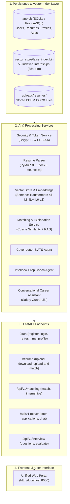

# Unified AI Internship Matching & Career Assistant System

[](https://www.python.org/)
[](https://fastapi.tiangolo.com/)
[](https://github.com/facebookresearch/faiss)
[](https://huggingface.co/sentence-transformers/all-MiniLM-L6-v2)
[](https://www.sqlalchemy.org/)
[](LICENSE)

---

### 🚀 1-Click Launch & Quick Access Buttons

| Action | One-Click Button | Direct Link |
| :--- | :--- | :--- |
| **Launch Web Portal** | [](http://localhost:8000) | [http://localhost:8000](http://localhost:8000) |
| **Interactive API Docs** | [](http://localhost:8000/docs) | [http://localhost:8000/docs](http://localhost:8000/docs) |
| **Deploy to Cloud (Free)** | [](https://render.com/deploy?repo=https://github.com/U-ARUN07/rag-internship-matching) | [Deploy on Render](https://render.com/deploy?repo=https://github.com/U-ARUN07/rag-internship-matching) |

> 💡 *Clicking the blue **Open Live Portal** button immediately opens `http://localhost:8000` in your browser.*

---

## 📌 Executive Summary

Engineered as a single, unified full-stack platform for the **Infosys Springboard Virtual Internship Program 7.0**, this system unifies all planned academic milestones and modules into a cohesive production application:

1. **Student Profile and Resume Management**: User registration, login, JWT access & refresh tokens with token rotation, bcrypt password hashing, and customizable student profiles.
2. **Resume Parsing and Skill Extraction**: Native document parser ingesting PDF (`PyMuPDF`) and DOCX (`python-docx`), extracting skills, education, and projects.
3. **Internship Knowledge Base and RAG Indexing**: 55 curated synthetic internship opportunities across 13 domains indexed into a 384-dimensional FAISS vector database.
4. **Job-Resume Matching and Compatibility Scoring Agent**: Semantic dense vector search with cosine similarity scoring and grounded anti-hallucinatory explanations.
5. **Skill Gap Analysis and Recommendation Agent**: Identifies matched vs missing technical skills and generates customized learning roadmaps.
6. **Resume and Cover Letter Customization Agent**: Generates professional, company-specific cover letters with ATS Compatibility Scoring and keyword suggestions.
7. **Interview Preparation and Question Generation Agent**: Generates 5 tailored technical, algorithmic, and behavioral interview questions with scoring rubrics and mock practice feedback.
8. **Application Tracking and Management**: Application submission, status lifecycle management (*Applied*, *Under Review*, *Interview Scheduled*, *Offer*), and cover letter archiving.
9. **Conversational Career Assistant**: RAG-powered chatbot with strict safety guardrails preventing out-of-scope queries.

---

## 🏗️ Unified Architecture



---

## ⚡ How to Run Locally

### Option 1: VS Code Shortcut (Recommended)
Press <kbd>Ctrl</kbd> + <kbd>Shift</kbd> + <kbd>B</kbd> in VS Code.
- Automatically frees port 8000 if occupied.
- Starts the server and opens `http://localhost:8000` in your browser.

### Option 2: 1-Click Batch Script
Double-click `run.bat` (or in terminal: `.\run.bat`).
- Automatically checks port 8000, starts `uvicorn`, and launches your browser.

### Option 3: Manual Terminal Command
```powershell
python -m uvicorn app.main:app --reload --host 127.0.0.1 --port 8000
```
Open **http://localhost:8000** in your browser.

---

## 🧪 Comprehensive Verification Suite

Run all 30 unit, integration, and platform test cases:
```powershell
python -m pytest
```
*Current Result: 30 Passed (100% Pass Rate).*

---

## 👥 Candidate & Project Metadata

- **Internship Program**: Infosys Springboard Virtual Internship Program 7.0
- **Candidate Name**: **Arun**
- **Repository**: [https://github.com/U-ARUN07/rag-internship-matching](https://github.com/U-ARUN07/rag-internship-matching)
- **Zero Configuration**: Runs with zero manual setup via bundled SQLite database and pre-indexed FAISS vectors.
