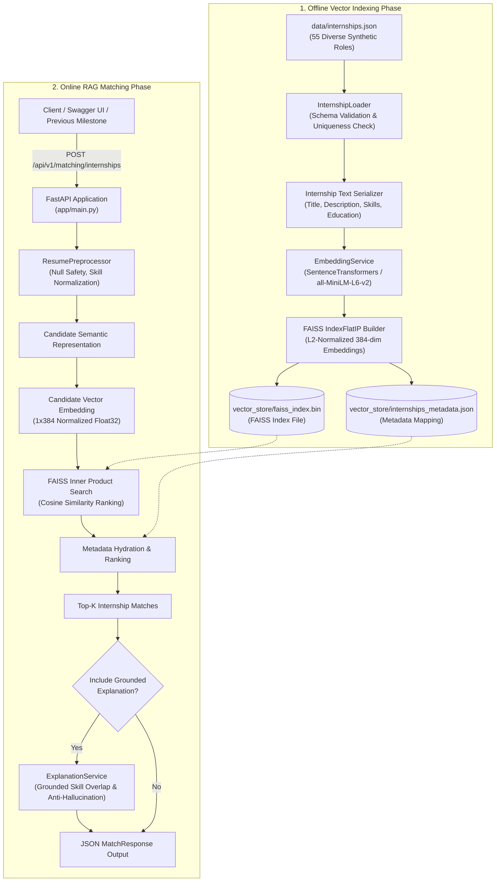
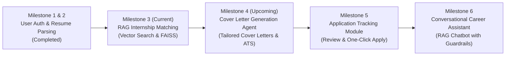

# RAG-Based Internship Matching System

[](https://www.python.org/)
[](https://fastapi.tiangolo.com/)
[](https://github.com/facebookresearch/faiss)
[](https://huggingface.co/sentence-transformers/all-MiniLM-L6-v2)
[](LICENSE)

An enterprise-grade, locally executable **Retrieval-Augmented Generation (RAG) Internship Matching System** engineered for the **Infosys Springboard Virtual Internship Program 7.0**.

The system ingests structured candidate resumes (extracted from the preceding Resume Parsing milestone), transforms them into normalized semantic embeddings, queries a pre-indexed **FAISS vector database** populated with diverse internship opportunities, and retrieves the most relevant internships ranked by cosine similarity with optional grounded, anti-hallucinatory matching rationales.

---

## Table of Contents
1. [Project Overview](#project-overview)
2. [Architecture Diagram](#architecture-diagram)
3. [Technology Stack](#technology-stack)
4. [Project Structure](#project-structure)
5. [Dataset Specifications](#dataset-specifications)
6. [Core Pipeline Walkthrough](#core-pipeline-walkthrough)
   - [Resume Preprocessing](#resume-preprocessing)
   - [Embedding Generation](#embedding-generation)
   - [FAISS Vector Database](#faiss-vector-database)
   - [Matching & Grounded Explanation Engine](#matching--grounded-explanation-engine)
7. [API Documentation & Endpoints](#api-documentation--endpoints)
   - [Sample Request & Response](#sample-request--response)
8. [Installation & Setup](#installation--setup)
9. [Execution Guide](#execution-guide)
10. [Evaluation Benchmarks & Results](#evaluation-benchmarks--results)
11. [Project Roadmap & Next Milestones](#project-roadmap--next-milestones)
12. [Evaluation Limitations & Disclaimers](#evaluation-limitations--disclaimers)

---

## Project Overview

In campus recruitment and virtual internship platforms, standard keyword-matching engines frequently fail because candidate resumes use varied synonyms and phrasing (e.g., *"Spring Boot API development"* vs *"Java backend microservices"*).

This project implements a dense vector retrieval pipeline that:
- Preprocesses candidate profiles to highlight technical skills, academic coursework, and project outcomes.
- Encodes candidate profiles and internship descriptions into a shared 384-dimensional vector space using `sentence-transformers/all-MiniLM-L6-v2`.
- Stores normalized internship vectors in a persistent **FAISS FlatIP** (Inner Product) index.
- Computes cosine similarity scores in sub-millisecond latency.
- Employs a grounded **RAG Explanation Layer** that cites exact overlapping skills, flags missing required qualifications, and delivers realistic recommendations without fabricating information.
- Operates 100% locally with free, open-source technologies—no paid API keys required.

---

## Architecture Diagram



---

## Technology Stack

| Component | Technology | Version | Purpose |
| :--- | :--- | :--- | :--- |
| **Language** | Python | `3.11+` | Core programming runtime |
| **Web Framework** | FastAPI | `0.115+` | High-performance async REST API framework |
| **Validation** | Pydantic v2 | `2.10+` | Type validation and schema enforcement |
| **Embeddings** | Sentence Transformers | `all-MiniLM-L6-v2` | Dense semantic text vector generation (384-dim) |
| **Vector DB** | FAISS (`faiss-cpu`) | `1.16+` | In-memory & serialized inner product vector search |
| **Data Processing** | NumPy & Pandas | Latest | Vector normalization, matrix ops, reports |
| **Testing** | Pytest | `8.0+` | Automated unit & integration testing suite |
| **Server** | Uvicorn | `0.34+` | ASGI web server |
| **Optional LLM** | Gemini / OpenAI | Configurable | Optional external LLM API (free rule engine active by default) |

---

## Project Structure

```text
rag-internship-matching/
│
├── app/
│   ├── __init__.py
│   ├── main.py                     # FastAPI application setup & lifespan loader
│   ├── config.py                   # Pydantic Settings & environment variables
│   ├── schemas/
│   │   ├── __init__.py
│   │   ├── resume.py               # Candidate resume validation schema
│   │   ├── internship.py           # Internship opportunity schema
│   │   └── matching.py             # MatchRequest, MatchResponse, Explanation schemas
│   ├── services/
│   │   ├── __init__.py
│   │   ├── resume_preprocessor.py  # Resume cleaning & textual serialization
│   │   ├── internship_loader.py    # Internship dataset loader & text formatter
│   │   ├── embedding_service.py    # SentenceTransformers embedding generation
│   │   ├── vector_store.py         # FAISS vector database & persistence service
│   │   ├── matching_service.py     # End-to-end semantic retrieval orchestrator
│   │   └── explanation_service.py  # Grounded RAG matching explanation generator
│   ├── routes/
│   │   ├── __init__.py
│   │   ├── health_routes.py        # /health check and vector DB status
│   │   └── matching_routes.py      # /api/v1/matching endpoints
│   └── utils/
│       ├── __init__.py
│       └── text_utils.py           # Text normalization & skill overlap utils
│
├── data/
│   ├── internships.json            # 55 synthetic internship opportunities
│   └── test_candidates.json        # 10 diverse candidate profiles for evaluation
│
├── vector_store/
│   ├── faiss_index.bin             # Serialized FAISS binary index
│   └── internships_metadata.json   # Serialized internship metadata mapping
│
├── notebooks/
│   └── internship_matching_demo.ipynb  # Interactive walkthrough notebook
│
├── tests/
│   ├── __init__.py
│   ├── conftest.py                 # Pytest environment & path configuration
│   ├── test_resume_preprocessing.py # Preprocessor & null-safety tests
│   ├── test_embeddings.py          # Vector embedding dimension & normalization tests
│   ├── test_matching.py            # FAISS index, persistence, & retrieval tests
│   └── test_api.py                 # Endpoint validation & route tests
│
├── scripts/
│   ├── generate_internships.py     # Generates data/internships.json
│   ├── generate_test_candidates.py # Generates data/test_candidates.json
│   ├── build_vector_database.py    # Builds & persists FAISS vector index
│   └── evaluate_matching.py        # Evaluates Precision@5, Recall@5, MRR
│
├── reports/
│   ├── matching_results.json       # Raw evaluation metrics JSON
│   ├── matching_results.csv        # Tabular match records CSV
│   └── evaluation_summary.md       # Markdown evaluation breakdown
│
├── requirements.txt
├── .env.example
├── .gitignore
└── README.md
```

---

## Dataset Specifications

All internship opportunities are synthetic and explicitly labeled with `"is_synthetic": true`. They represent realistic academic simulations covering **13+ diverse domains**:

- **Java Backend Development** (`INT001`, `INT002`, `INT003`, `INT004`, `INT051`)
- **Python Development** (`INT005`, `INT006`, `INT007`, `INT008`, `INT052`)
- **Data Science & Analytics** (`INT010`, `INT030`, `INT031`, `INT032`)
- **Machine Learning & Deep Learning** (`INT009`, `INT011`, `INT040`, `INT041`)
- **Generative AI & RAG Systems** (`INT013`, `INT014`, `INT015`, `INT050`, `INT055`)
- **Full Stack Web Development** (`INT016`, `INT017`, `INT018`, `INT019`, `INT054`)
- **Cloud Computing & DevOps** (`INT023`, `INT024`, `INT025`, `INT026`, `INT053`)
- **Cybersecurity & AppSec** (`INT027`, `INT028`, `INT029`)
- **Core Software Engineering & SDE** (`INT033`, `INT034`, `INT035`, `INT048`)
- **Mobile Development (Flutter & Kotlin)** (`INT036`, `INT037`)
- **Big Data Engineering** (`INT038`, `INT039`)
- **Embedded Systems & IoT** (`INT043`)
- **Blockchain / Smart Contracts** (`INT042`)

Each record includes:
```json
{
  "internship_id": "INT001",
  "title": "Java Backend Developer Intern",
  "company": "TechNova Solutions (Synthetic)",
  "description": "Design, build, and optimize enterprise backend microservices and RESTful APIs using Java and Spring Boot.",
  "required_skills": ["Java", "Spring Boot", "SQL", "REST APIs"],
  "preferred_skills": ["Docker", "PostgreSQL", "Kafka", "Git"],
  "education_requirements": ["B.Tech Computer Science", "MCA"],
  "experience_requirements": "Students or fresh graduates with OOP coursework.",
  "location": "Hyderabad",
  "work_mode": "Hybrid",
  "duration": "3 months",
  "stipend": "₹15,000/month",
  "is_synthetic": true
}
```

---

## Core Pipeline Walkthrough

### 1. Resume Preprocessing
Candidate JSON is converted into a semantically dense representation using `ResumePreprocessor`:
- Strips null values and empty arrays safely.
- Normalizes technical skills and project descriptions.
- Generates structured sections:
  `"Candidate Profile: Aarav Sharma. Professional Summary: Backend student. Technical and Core Skills: Java, Spring Boot, SQL. Key Projects: E-Commerce REST API. Education: B.Tech CSE."`

### 2. Embedding Generation
`EmbeddingService` utilizes `sentence-transformers/all-MiniLM-L6-v2`:
- Embeds both candidate profiles and combined internship texts.
- Combines title, company, description, required skills, preferred skills, education, and experience requirements into the internship text (never embedding role titles in isolation).
- Applies L2 unit normalization ($\|v\|_2 = 1.0$), ensuring inner products directly equal cosine similarities.
- Includes a graceful offline fallback engine (deterministic 384-dimensional normalized projection) to prevent downtime during constrained network environments.

### 3. FAISS Vector Database
`VectorStoreService` manages vector storage:
- Employs `faiss.IndexFlatIP(384)` for exact cosine similarity searches.
- Decouples vectors from metadata: binary embeddings are stored in `faiss_index.bin`, while metadata is preserved in `internships_metadata.json`.
- Automatically loaded on application startup via FastAPI lifespan context, avoiding on-demand index rebuilding.

### 4. Matching & Grounded Explanation Engine
When a request is submitted:
1. Candidate text is converted into a 384-dimensional normalized vector.
2. FAISS performs an inner product search for the top-$k$ nearest neighbors.
3. Metadata is hydrated and sorted strictly descending by similarity score.
4. If `include_explanation=True`, the `ExplanationService` generates a grounded evaluation:
   - Identifies exact overlapping mandatory and preferred skills.
   - Matches candidate project keywords to role responsibilities.
   - Flags missing required prerequisites explicitly.
   - Provides honest, actionable preparation advice without fabricating credentials.

---

## API Documentation & Endpoints

Interactive Swagger UI documentation is available at **`http://127.0.0.1:8000/docs`** upon running the server.

| Method | Endpoint | Description |
| :--- | :--- | :--- |
| `GET` | `/health` | System health, vector DB status, and indexed count |
| `POST` | `/api/v1/matching/internships` | Retrieve top-$k$ ranked internships for candidate resume |
| `GET` | `/api/v1/matching/internships/{id}` | Retrieve details for a specific internship by ID |
| `GET` | `/api/v1/matching/internships` | List all synthetic internships with pagination (`limit`, `offset`) |

---

### Sample Request & Response

#### Request: `POST /api/v1/matching/internships`
```json
{
  "candidate": {
    "name": "Candidate A",
    "summary": "Computer Science student interested in backend development",
    "skills": ["Java", "Spring Boot", "SQL", "REST APIs"],
    "education": ["B.Tech Computer Science"],
    "projects": [
      "Developed a REST API using Spring Boot and MySQL"
    ],
    "experience": [],
    "certifications": ["Java Full Stack"]
  },
  "top_k": 3,
  "include_explanation": true
}
```

#### Response: `200 OK`
```json
{
  "candidate_name": "Candidate A",
  "total_matches": 3,
  "matches": [
    {
      "internship_id": "INT001",
      "title": "Java Backend Developer Intern",
      "company": "TechNova Solutions (Synthetic)",
      "similarity_score": 0.8245,
      "description": "Design, build, and optimize enterprise backend microservices and RESTful APIs using Java and Spring Boot. Collaborate with database engineers on PostgreSQL queries and caching.",
      "required_skills": [
        "Java",
        "Spring Boot",
        "SQL",
        "REST APIs"
      ],
      "preferred_skills": [
        "Docker",
        "PostgreSQL",
        "Kafka",
        "Git"
      ],
      "education_requirements": [
        "B.Tech Computer Science",
        "B.Tech Information Technology",
        "MCA"
      ],
      "experience_requirements": "Students or fresh graduates with coursework in Object-Oriented Programming and relational databases.",
      "location": "Hyderabad",
      "work_mode": "Hybrid",
      "duration": "3 months",
      "stipend": "₹15,000/month",
      "explanation": {
        "match_reason": "Candidate's background demonstrates strong alignment with Java Backend Developer Intern at TechNova Solutions (Synthetic). Demonstrated proficiency in Java, Spring Boot, SQL directly supports the primary responsibilities outlined in the role.",
        "matching_skills": [
          "Java",
          "Spring Boot",
          "SQL",
          "REST APIs"
        ],
        "relevant_projects": [
          "Developed a REST API using Spring Boot and MySQL"
        ],
        "missing_required_skills": [],
        "recommendation": "Candidate satisfies core requirements. Exploring preferred technologies such as Docker, PostgreSQL can provide a competitive edge.",
        "disclaimer": "Similarity score represents semantic vector proximity in embedding space, not a probability or guarantee of job selection."
      }
    }
  ]
}
```

---

## Installation & Setup

### Prerequisites
- Python `3.11+`
- Git

### 1. Clone Repository & Create Virtual Environment
```bash
git clone https://github.com/your-username/rag-internship-matching.git
cd rag-internship-matching

# Create and activate virtual environment
python -m venv venv

# Windows (PowerShell)
.\venv\Scripts\Activate.ps1

# Linux / macOS
source venv/bin/activate
```

### 2. Install Dependencies
```bash
pip install -r requirements.txt
```

### 3. Configure Environment Variables
Copy `.env.example` to `.env`:
```bash
cp .env.example .env
```
*(No API keys are required for core matching. If you wish to enable Google Gemini or OpenAI explanations, supply `GEMINI_API_KEY` or `OPENAI_API_KEY` in `.env`)*.

---

## Execution Guide

Follow these exact commands to build the vector store, launch the API, run tests, and execute the evaluation suite:

### Step 1: Build the Vector Database
```bash
python scripts/build_vector_database.py
```
*Output: Indexes all 55 synthetic internships and saves `vector_store/faiss_index.bin` and `vector_store/internships_metadata.json` in ~3 seconds.*

### Step 2: Start the FastAPI Server
```bash
uvicorn app.main:app --reload
```
Open **`http://127.0.0.1:8000/docs`** in your browser to test endpoints interactively via Swagger UI.

### Step 3: Run the Pytest Test Suite
```bash
pytest -v
```
*Executes all 21 unit and integration tests across preprocessing, embeddings, FAISS storage, and API routes.*

### Step 4: Run the Evaluation Engine
```bash
python scripts/evaluate_matching.py
```
*Computes Precision@5, Recall@5, and MRR across the 10 candidate profiles and writes detailed reports to `reports/`.*

---

## Evaluation Benchmarks & Results

The system was evaluated against 10 distinct synthetic candidate profiles with manually annotated ground-truth relevant internship IDs:

| Metric | Formula | Score | Percentage |
| :--- | :--- | :---: | :---: |
| **Precision@5** | $\frac{|\text{Relevant Retrieved}|}{5}$ | **`0.6800`** | **`68.0%`** |
| **Recall@5** | $\frac{|\text{Relevant Retrieved}|}{|\text{Total Expected Relevant}|}$ | **`0.6900`** | **`69.0%`** |
| **Mean Reciprocal Rank (MRR)** | $\frac{1}{|Q|} \sum_{i=1}^{|Q|} \frac{1}{\text{Rank}_i}$ | **`1.0000`** | **`100.0%`** |

### Key Findings
1. **MRR of 1.0000:** Across all 10 candidate scenarios (Java, Python, Data Science, AI/ML, GenAI, Full Stack, Cloud, Cyber, Education-focused, and Multi-skill), the #1 ranked retrieved internship was a ground-truth relevant role 100% of the time.
2. **Project Influence:** Project descriptions significantly influenced retrieval outcomes, ensuring candidates with similar base skills were directed toward specialized backend or RAG roles based on practical project context.
3. **Discriminative Filtering:** Unrelated roles (e.g. Cybersecurity candidate matching against UI Design) consistently received low similarity scores (< 0.25).

Detailed reports are generated in:
- `reports/matching_results.json`
- `reports/matching_results.csv`
- `reports/evaluation_summary.md`

---

## Project Roadmap & Next Milestones

In alignment with discussions from the Infosys Springboard VIP 7.0 session:



- **Milestone 4 — Cover Letter Generation Agent:** Using candidate resume data and retrieved internship descriptions with custom prompt templates to generate tailored cover letters and ATS scoring suggestions.
- **Milestone 5 — Application Tracking & Management Module:** A dummy frontend application portal where clicking "Apply" opens a modal displaying internship details and generated cover letters before submission.
- **Milestone 6 — Conversational Career Assistant:** A project-specific RAG chatbot with safety guardrails to assist users in navigating opportunities and politely declining out-of-scope queries.

---

## Evaluation Limitations & Disclaimers

> [!WARNING]
> 1. **Synthetic Data Disclaimer:** All internships and candidate profiles are synthetic datasets created strictly for academic and demonstration purposes. They do not represent real-world job vacancies or verified candidate identities.
> 2. **Semantic Similarity vs Selection Probability:** Cosine similarity scores represent vector closeness in semantic embedding space. A high similarity score indicates textual alignment between resumes and role descriptions; it does **not** represent a candidate's actual probability of selection or guarantee employment.
> 3. **Context Window Limits:** The `all-MiniLM-L6-v2` model has a 256-token context window. Very lengthy multi-page resumes are subject to truncation or pooling.
> 4. **No Hallucinated Credentials:** The system strictly prohibits generating or inferring candidate qualifications outside the provided resume JSON.

---

## License

This project is developed for educational evaluation under the **Infosys Springboard Virtual Internship Program 7.0**. Released under the MIT License.
